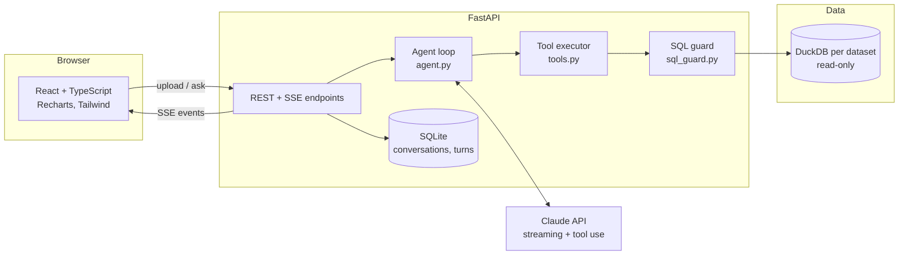

# DataPilot — AI Data Analyst Agent

> Upload a spreadsheet, ask a question in plain language, and watch an AI agent explore the data, write SQL,
> build charts and explain what it found, with every step visible and verifiable.

DataPilot is a full-stack agentic application built on **Claude** with tool use. It is not a chatbot that guesses
numbers: every figure in an answer comes from a SQL query executed against your data in a sandboxed, read-only
**DuckDB** engine, and every query is shown in the UI so you can inspect it.


-0d0d0d)

---

## Features

- **Agentic analysis loop.** Claude plans, calls tools, reads results, notices problems (nulls, outliers, wrong
  grain) and iterates until it can answer, up to a configurable step budget.
- **Three focused tools.**
  - `run_sql`: read-only DuckDB SQL with a row cap and timeout.
  - `profile_column`: stats and distribution for one column (numeric, temporal or categorical).
  - `create_chart`: runs a query and renders bar, line, area, scatter or donut charts.
- **Live streaming UI.** Thinking summaries, narration, tool calls and results stream to the browser over SSE as they
  happen. Tool cards expand to show the SQL, the result table and a CSV download.
- **Any tabular file.** CSV/TSV, Excel (every sheet becomes a table), Parquet, JSON/JSONL. Columns are normalised to
  `snake_case` and each table is profiled on upload so the agent starts with a schema summary.
- **Suggested questions** are generated per dataset with structured outputs. If no API key is set, the app falls back
  to heuristic suggestions.
- **Persistent analyses.** Conversations and their full event timelines are stored in SQLite, so past runs replay
  exactly as they streamed.
- **Cost transparency.** Each answer shows model, steps, latency, tokens (including prompt cache hits) and an
  estimated cost.
- **Accessible charts.** They use a validated colour-blind-safe palette, hover tooltips, legends and a table view for
  every chart.

## Architecture



**One question, end to end:**

1. `POST /api/conversations/{id}/messages` opens an SSE stream.
2. The agent sends the conversation history, the system prompt (with the dataset's schema profile) and the tool
   definitions to Claude using streaming.
3. Streamed blocks (thinking, text, tool-use drafts) are normalised into UI events and forwarded immediately.
4. When Claude stops with `tool_use`, all requested tools run in parallel in worker threads, and their results go
   back to the model and to the UI.
5. The loop continues until Claude ends its turn or the step budget runs out. At that point it is forced to write a
   final answer with no further tools.
6. The completed exchange is appended to the history, and the compacted event log is saved for replay.

## Design decisions

| Concern | Decision |
|---|---|
| **SQL safety** | Three independent layers. (1) `sql_guard` accepts a single read-only statement (`SELECT`, `WITH`, `SUMMARIZE`, `PIVOT`, …) and rejects DDL/DML, `ATTACH`, `COPY`, `PRAGMA`, file-reading table functions, etc., after stripping comments and string literals. (2) The DuckDB connection is opened `read_only`. (3) `enable_external_access=false` plus `lock_configuration=true`, so even a bypass cannot read files or the network. |
| **Runaway queries** | Every query runs with a timer that calls `interrupt()` on the cursor, plus a hard row cap. Large results are truncated for both the model and the UI, and the agent is told when this happens. |
| **Faithful conversation history** | Assistant turns are stored exactly as returned, including thinking blocks, and only appended to, which keeps prompt caching effective across turns. Interrupted or failed runs are never persisted, so history can't contain a dangling `tool_use`. |
| **Robust stop reasons** | `max_tokens` with an unfinished tool call: the partial call is dropped, not executed. `pause_turn` is resumed. `refusal` is reported to the user and not persisted. Broken streams are retried and the UI discards that step's partial output. |
| **Server-side fallbacks** | Requests opt into server-side refusal fallbacks (`fallbacks: "default"`). If the primary model declines, the API transparently retries on the recommended fallback model, and the client cleans up the response before saving it to history. Toggle with `DATAPILOT_ENABLE_FALLBACKS`. |
| **Adaptive reasoning** | Adaptive thinking with summarised display and a configurable effort level (`low` … `max`) trades depth for latency and cost. |
| **Demo mode** | Without an API key the backend swaps Claude for `DemoLLM`, an offline rule-based model behind the same `LLMClient` protocol. It reads the schema from the system prompt, maps the question to a recipe (trend, ranking, distribution, relationship, overview), issues real tool calls, and writes the answer from the returned tables. The agent loop, SQL guard, DuckDB, charts and streaming all run for real. |
| **Testability** | The LLM sits behind a small `LLMClient` protocol. Tests drive the real agent loop, tools and HTTP API with a scripted fake model, so the suite needs no network or API key. |
| **Chart design** | Series are capped at 8 to match the categorical palette; extra series fold into "Other" instead of generating new colours. Single-axis charts only, thin marks, and a table view for every chart. |

## Quick start

### Option A: Docker (recommended)

```bash
cp .env.example .env        # then set ANTHROPIC_API_KEY (or leave it empty for demo mode)
docker compose up --build
```

Open <http://localhost:8080> and click **Try the sample dataset**.

### Demo mode (no API key, no cost)

Leave `ANTHROPIC_API_KEY` empty and the app starts in **demo mode**. A "Demo" badge and banner appear in the UI,
and questions are answered by an offline rule-based agent instead of Claude. It still plans, runs real read-only SQL on
DuckDB, draws charts and streams every step, so you can try the whole product for free. It understands the common
question shapes, in English or Vietnamese:

- trends over time: *"How has revenue changed month by month?"*, *"Doanh thu theo tháng của từng kênh?"*
- rankings and breakdowns: *"Which city has the highest profit?"*, *"How many orders per channel?"*
- distributions and outliers: *"What does the distribution of revenue look like?"*
- relationships between two numeric columns: *"Does discount affect rating?"*
- dataset overview and data quality

Anything else falls back to an overview. Set `DATAPILOT_DEMO_MODE=true` to force demo mode even when a key is
configured (useful for a public portfolio deployment), or `false` to disable it.

### Option B: Local development

Prerequisites: Python 3.11+ and Node 20+.

```bash
# Backend
cd backend
python -m venv .venv
source .venv/bin/activate          # Windows: .venv\Scripts\activate
pip install -r requirements-dev.txt
cp .env.example .env               # set ANTHROPIC_API_KEY, or leave empty for demo mode
uvicorn app.main:create_app --factory --reload
```

```bash
# Frontend (in a second terminal)
cd frontend
npm install
npm run dev
```

Open <http://localhost:5173>. The Vite dev server proxies `/api` to the backend on port 8000.

### Tests

```bash
cd backend && pytest -q && ruff check .
cd frontend && npm test && npm run build
```

## Configuration

All settings are environment variables. They can also go in `backend/.env`.

| Variable | Default | Description |
|---|---|---|
| `ANTHROPIC_API_KEY` | none | Enables analysis with Claude. Without it (and without `GEMINI_API_KEY`) the app runs in demo mode. |
| `DATAPILOT_DEMO_MODE` | auto | `true`/`false` forces the offline demo agent on or off. Unset = on only when no key is set. |
| `DATAPILOT_MODEL` | `claude-opus-5-5` | Claude model used by the agent. |
| `DATAPILOT_EFFORT` | `medium` | Reasoning effort: `low`, `medium`, `high`, `xhigh`, `max`. |
| `DATAPILOT_MAX_AGENT_STEPS` | `12` | Tool-use rounds before the agent must answer. |
| `DATAPILOT_ENABLE_FALLBACKS` | `true` | Server-side refusal fallback to the recommended model. |
| `DATAPILOT_MAX_UPLOAD_MB` | `50` | Upload size limit. |
| `DATAPILOT_SQL_TIMEOUT_S` | `20` | Per-query timeout. |
| `DATAPILOT_DATA_DIR` | `data` | Where datasets and the SQLite store live. |

## Other LLM providers (Gemini, Ollama)

Claude is the default and recommended provider. For a free setup, the agent can also run on **Google Gemini**
(free API tier) or a **local Ollama** model, through their OpenAI-compatible endpoints.

**How it fits in.** The agent loop only talks to the `LLMClient` protocol. `app/openai_compat.py` is a second
implementation of it, next to `ClaudeLLM` in `app/llm.py`, which is unchanged. The adapter translates at the edge:
the agent, tools, stored history (`tool_use` / `tool_result` blocks), UI and event stream are the same for every
provider. A conversation started on one provider can be continued on another.

**Choosing a provider.** With `DATAPILOT_PROVIDER` unset, the backend picks automatically:

1. `ANTHROPIC_API_KEY` set: Claude, exactly as before.
2. Otherwise `GEMINI_API_KEY` set: Gemini.
3. Otherwise: demo mode.

Ollama needs no key, so it is only used when you ask for it with `DATAPILOT_PROVIDER=ollama`.

```bash
# Gemini: create a free key at https://aistudio.google.com/apikey
GEMINI_API_KEY=your-key

# Ollama: install from https://ollama.com, then
ollama pull qwen3:8b
DATAPILOT_PROVIDER=ollama
```

| Variable | Default | Description |
|---|---|---|
| `DATAPILOT_PROVIDER` | auto | `claude`, `gemini` or `ollama`. Unset = the order above. |
| `GEMINI_API_KEY` | none | Google AI Studio key. |
| `DATAPILOT_GEMINI_MODEL` | `gemini-3.5-flash` | Any Gemini model with function calling. |
| `DATAPILOT_OLLAMA_BASE_URL` | `http://localhost:11434/v1` | In Docker Compose it defaults to `http://host.docker.internal:11434/v1`. |
| `DATAPILOT_OLLAMA_MODEL` | `qwen3:8b` | Pick a model with tool-calling support. |
| `DATAPILOT_COMPAT_TIMEOUT_S` | `300` | Read timeout. Local models can be slow. |

`/api/health` reports the active `provider` and `model`.

**Free-tier quota.** Google counts the Gemini free tier per model and per project, and some models allow only about 20
requests a day. One question takes 2 to 6 requests. When a model's daily quota runs out, the agent reports the `429`
and you can switch `DATAPILOT_GEMINI_MODEL` to another model (for example `gemini-3.5-flash-lite`). Very new preview
models are often slow and return `503` under load; the default `gemini-3.5-flash` is a good balance.

**Trade-offs.** These apply only while a non-Claude provider is active:

| Feature | Claude | Gemini / Ollama |
|---|---|---|
| Analysis quality | Best: plans multi-step SQL, checks its own results | Good with Gemini Flash. Small local models make more SQL mistakes and stop earlier. |
| Thinking panel | Summarised adaptive thinking | Shown only when the model streams reasoning (for example Ollama `qwen3`). |
| Prompt caching | Explicit caching across agent steps | Whatever the provider does on its own |
| Refusal fallback | Server-side fallback model | Not available. A refusal ends the turn. |
| Suggested questions | Structured outputs | JSON schema response format, with the heuristic suggestions as fallback |
| Cost estimate | From the pricing table | Shown as `n/a`. Free tiers have rate limits; `429` responses are retried with backoff. |

Ollama: the default context window of many models is small. Raise it, for example with
`OLLAMA_CONTEXT_LENGTH=32768 ollama serve`, so the schema, tool results and history fit.

**Going back to Claude.** Set `ANTHROPIC_API_KEY`, and unset `DATAPILOT_PROVIDER` or set it to `claude`. Then
restart the backend. No code or data changes are needed.

## Sample dataset

`backend/samples/ecommerce_sales.csv` is a synthetic Vietnamese e-commerce dataset with about 8.5k orders across
2024–2025. It is generated deterministically by `python -m scripts.generate_sample_data`, and has real patterns
for the agent to discover:

- the Tết (Lunar New Year) rush and the lull after it
- double-day sales spikes (9.9, 10.10, 11.11, 12.12)
- Mobile App's growing share of orders
- slower delivery outside Hồ Chí Minh/Hà Nội, which drags ratings down
- about 17% missing ratings

Try asking:

- *"How did monthly revenue evolve, and what explains the peaks?"*
- *"Which channel is growing fastest year over year?"*
- *"Does delivery time affect customer ratings? Break it down by city."*

## Project structure

```
datapilot/
├── backend/
│   ├── app/
│   │   ├── main.py          # FastAPI app factory, REST + SSE routes
│   │   ├── agent.py         # Agent loop, stop-reason handling, retries, cost estimate
│   │   ├── llm.py           # Claude client (streaming, structured outputs) behind a protocol
│   │   ├── openai_compat.py # Same protocol for Gemini / Ollama (OpenAI-compatible endpoints)
│   │   ├── demo.py          # Offline rule-based LLM for demo mode
│   │   ├── tools.py         # Tool schemas + executor (run_sql, profile_column, create_chart)
│   │   ├── prompts.py       # System prompt built from the dataset profile
│   │   ├── datasets.py      # Ingestion, profiling, sandboxed DuckDB querying
│   │   ├── sql_guard.py     # Read-only SQL validation
│   │   ├── store.py         # SQLite persistence for datasets, conversations, turns
│   │   ├── schemas.py       # Request/response models
│   │   ├── sample_data.py   # Synthetic dataset generator
│   │   └── config.py        # Settings + pricing table
│   ├── tests/               # pytest suite (agent loop, tools, SQL guard, API)
│   └── Dockerfile
├── frontend/
│   ├── src/
│   │   ├── api/             # Typed REST client + SSE parser
│   │   ├── state/           # Event reducer shared by live runs and replays
│   │   ├── components/      # Sidebar, TurnView, ToolCard, ChartCard, SchemaPanel, ...
│   │   └── lib/             # Formatting, chart palette
│   ├── nginx.conf           # SPA + SSE-friendly reverse proxy
│   └── Dockerfile
├── docker-compose.yml
└── .github/workflows/ci.yml
```

---

## Hướng dẫn nhanh (Tiếng Việt)

**DataPilot** là một AI agent phân tích dữ liệu.

**Cách hoạt động:**

1. Bạn tải lên file CSV, Excel, Parquet hoặc JSON.
2. Bạn đặt câu hỏi bằng ngôn ngữ tự nhiên.
3. Claude tự lập kế hoạch, viết SQL chạy trên DuckDB (chỉ đọc, có sandbox), vẽ biểu đồ và giải thích kết quả.
4. Toàn bộ quá trình suy luận và từng câu SQL được stream trực tiếp lên giao diện để bạn kiểm chứng.

**Chạy nhanh bằng Docker:**

```bash
cp .env.example .env   # điền ANTHROPIC_API_KEY, hoặc để trống để chạy chế độ demo
docker compose up --build
```

**Chế độ demo (không cần API key, miễn phí):** nếu để trống `ANTHROPIC_API_KEY`, ứng dụng tự chạy ở chế độ demo. Giao
diện hiện nhãn "Demo". Câu hỏi được trả lời bởi một agent theo luật chạy offline thay cho Claude. Agent này vẫn lập
kế hoạch, chạy SQL thật trên DuckDB, vẽ biểu đồ và stream từng bước. Nó hiểu các dạng câu hỏi phổ biến bằng tiếng
Việt hoặc tiếng Anh:

- xu hướng theo thời gian
- xếp hạng và so sánh nhóm
- phân phối và giá trị ngoại lai
- quan hệ giữa hai cột số
- tổng quan dữ liệu

Đặt `DATAPILOT_DEMO_MODE=true` để luôn bật demo, kể cả khi đã có key.

Sau đó mở <http://localhost:8080> và bấm **Try the sample dataset**. Bộ dữ liệu mẫu là đơn hàng thương mại điện tử
Việt Nam năm 2024–2025, có sẵn các xu hướng thật để agent khám phá:

- mùa Tết
- các ngày sale đôi như 11.11
- kênh Mobile App tăng trưởng
- giao hàng chậm làm giảm đánh giá

**Điểm nổi bật kỹ thuật:**

- Vòng lặp agent tự viết, không dùng framework. Xử lý đầy đủ các `stop_reason` và retry khi stream lỗi.
- Bảo mật SQL ba lớp.
- Lịch sử hội thoại được giữ nguyên văn để tận dụng prompt caching.
- Bật sẵn cơ chế fallback phía server khi model từ chối.
- Bộ test chạy hoàn toàn offline nhờ một fake LLM.

**Dùng Gemini hoặc Ollama (miễn phí):**

- Không có Claude API key thì có thể điền `GEMINI_API_KEY` (lấy miễn phí ở Google AI Studio), hoặc đặt
  `DATAPILOT_PROVIDER=ollama` để chạy model local.
- Kiến trúc không đổi. Adapter mới nằm trong `app/openai_compat.py`, và `ClaudeLLM` giữ nguyên.
- Chất lượng phân tích phụ thuộc vào model. Một số tính năng chỉ Claude có: prompt caching, adaptive thinking,
  fallback khi bị từ chối.
- Khi có Claude key: điền `ANTHROPIC_API_KEY` rồi khởi động lại backend, hệ thống chạy lại với Claude như cũ.
  Xem chi tiết ở mục "Other LLM providers".
- Gói Gemini miễn phí giới hạn số request mỗi ngày theo từng model (có model chỉ khoảng 20 request/ngày). Hết quota
  thì đổi `DATAPILOT_GEMINI_MODEL` sang model khác, ví dụ `gemini-3.5-flash-lite`.
